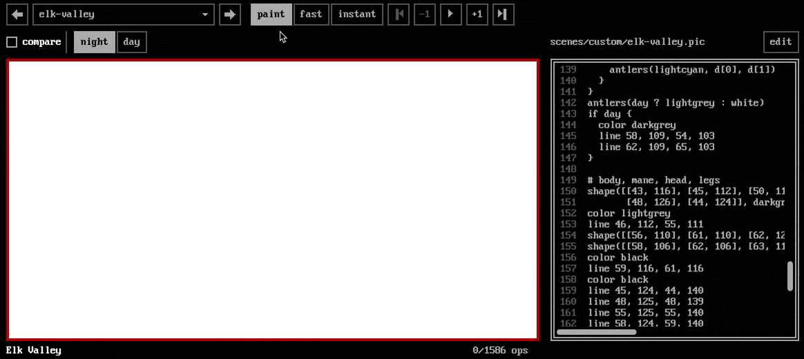
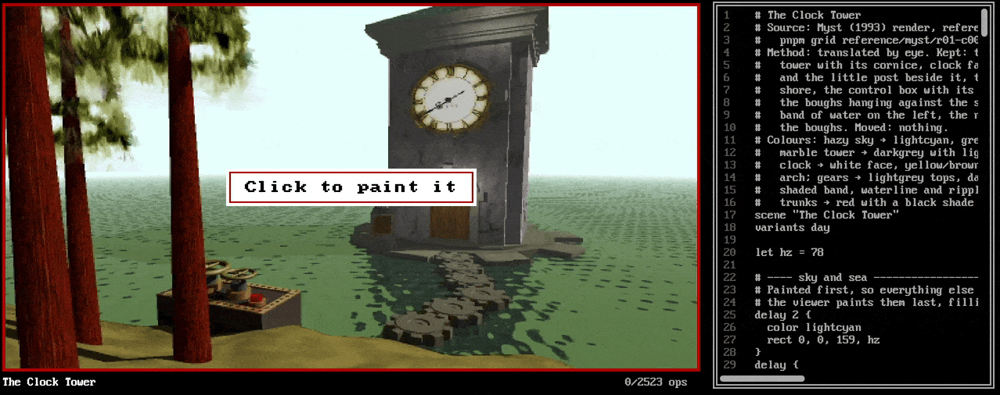
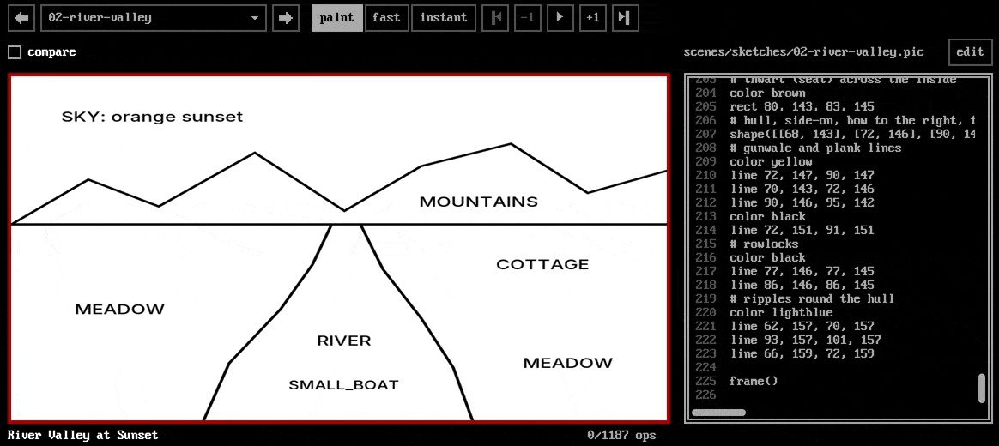

# Paint Quest

A series of LLM skills for producing early Sierra AGI-style adventure game scenes from a custom LOGO-inspired **drawing instruction set** instead of bitmaps.

**Live site: https://kq-styles.specr.net**

- **PicScript**: a small Logo-flavoured language that compiles to AGI picture operations
  (colour, lines, white-only flood fill, brush plots).
- **A browser viewer** (Vite + TypeScript + p5.js) that repaints each scene stroke by stroke.
- **Two skills.** `old-adventure-game-draw` composes new scenes from a description.
  `old-adventure-game-from-image` translates a picture you give it (screenshot, painting,
  pixel art, a tile from a sheet) into a KQ-style scene .

> [!NOTE]
> These skills are designed to be piloted by a multimodal LLM - they rely on the model's ability to interpret both textual descriptions and visual inputs to generate or translate scenes accurately. They have been tested with GLM 5.3 and Opus 5.5, and also work with smaller locally-hostable models such as Qwen 3.8 27b.

## Demos

  > Use the Old Adventure Game draw skill to draw a scene of a starry black sky over icy mountains,
  > and a green-hued valley with a solitary elk with glowing antlers. Make a day and night version 
  > of it as well



  > Use the old-adventure-game-draw-from-image skill to recreate this image: myst-clocktower.png



  > Use the old-adventure-game-draw-from-image skill to generate a KQ-style scene from the sketch: river-boat.png



## FAQ

### Who is this tool for?

That’s a good question. I initially built it for myself to help with the rapid creation of scenes in a traditional point-and-click adventure game I’m working on. Later, I decided to open-source it in case anyone else might find it useful.

### Why favor a tool-driven procedural graphics approach instead of just using a conventional GenAI model like GPT-Image-2 or Nano Banana?

For a couple of reasons. First, because every picture is composed of PicScript instructions, it’s trivial to modify without any loss in quality. Whereas when you use most generative AI models (even some of the most state-of-the-art ones) with continuous masking and inpainting, they can start to suffer from a small amount of signal degradation over time. Since this is procedural, that isn’t an issue.

The second reason is that we’re using this to generate very simple bitmaps with very restricted color palettes. While there are systems that can do this, they tend to be the exception than the rule. Even if you define a specific palette, there’s a very good chance that if you zoom in heavily on an image generated by something like GPT-Image-2, you’re going to notice fringing and inadvertent high-frequency noise, which means more post-processing work to reduce the palette.

It also helps maintain stylistic continuity across all of your images.

## Quick start

Needs [Node.js](https://nodejs.org) and pnpm (`npm install -g pnpm`).

```bash
pnpm install
pnpm dev   # http://localhost:5250
```

Use an agentic harness such as OpenCode or PI to interact with the skills programmatically.

## PicScript

```js
scene "Apple tree"
variants day, night

sky 16
hills 8, 26
ground 26
tree 80, 140, 1.4, seed: 7

fn apple(x, y, c = red) {
  color c
  rect x, y, x + 1, y + 1
}
for i in 0..6 {
  apple(66 + noise(1, i) * 28, 60 + noise(2, i) * 30)
}
apple(86, 64, yellow)          # the golden one

if variant == "night" {
  night()
  moon 130, 10, 5
}
frame
```

The full reference is `skills/old-adventure-game-draw/references/picscript.md`. The
standard library, with a thumbnail for each function, is in
`skills/old-adventure-game-draw/references/stdlib.md`.

### `delay`: paint a backdrop last without covering anything

Scenes paint back to front, so their first instructions are usually a full-screen sky or wall.
Painted over an original picture, that hides the whole original at once. A `delay` block changes
only *when the viewer shows* what's inside it, never the picture:

```js
delay 2 {                 # the sky, last of all
  color lightcyan
  rect 0, 0, 159, 80
}
delay {                   # the sea, before the sky (no number means 1)
  color cyan
  rect 0, 81, 159, 167
}
rock 70, 120              # everything else is shown first, over the original
```

The script still runs top to bottom, so fills, remaps, lint, `pnpm render` and the finished
picture are exactly what they'd be without the `delay`. The viewer plays the held-back
instructions after the rest (lower numbers first), and stacking stays in script order: each pixel
shows the latest instruction in the script that has painted it, so a delayed sky only fills in
where nothing after it in the script has painted. A `delay` has no scope of its own (a `let` or
`fn` inside it is visible around it), so wrapping lines in one never changes what they do. The
Myst and KQ6 scenes use it for their skies, seas, back walls and other big backdrops.

### `object`: name the things in a scene

A scene is a background for an adventure game, so it can say which instructions paint which
thing. A game can then take the vase away when the player picks it up, or use the door as a
hotspot:

```js
shape(r[4], darkgrey)     # the floor: backdrop, in no object
object "table" {
  shape([[64, 120], [96, 120], [99, 126], [61, 126]], brown)
}
object "vase" {           # stands on the table: its own object, drawn after it
  color blue
  ellipse 80, 116, 2, 4
}
object "fireplace" {
  shape(archway(98, 87, 8, 4, 112), black)
  object "fire" { … }     # a part: hiding the fireplace hides its fire
}
```

Hiding an object shows what was painted behind it. The picture is rebuilt from what every other
instruction painted in the full picture, so a later fill can't spill into the gap. Like `delay`,
an `object` block has no scope of its own and never changes the picture. In the viewer, hover over
a finished scene to see what each thing is, and click it (or its key under the picture) to hide or
show it. `pnpm lint:pic` checks that every object can be hidden cleanly, and `pnpm objects`
exports the scene for a game engine. `scenes/sketches/03-cottage-kitchen.pic` is an example.

## Scripts

| script | what it does |
|---|---|
| `pnpm dev` / `preview` | viewer on port **5250** (dev server / built app) |
| `pnpm build` | typecheck and build the viewer into `dist/` |
| `pnpm test` | unit, golden (75 exact + 6 ≥ 90%) and CLI tests (Vitest) |
| `pnpm test:e2e` | Playwright tests (their own server on port 5251; run `pnpm exec playwright install chromium` once first) |
| `pnpm render <scene.pic> [--variant all] [--compare] [--confusion] [--steps n] [--beside picture.png] [--overlay ink.png]` | render to `out/*.png` |
| `pnpm grid <image> [--trim] [--anchor top] [--tile 11x8:3,1] [--fit]` | reframe a source image to the 1.9:1 screen and write gridded copies for translating it by eye; `--fit` (or a `.txt` ASCII layout) is for layout sketches (needs ImageMagick; `--help` lists every option) |
| `pnpm lint:pic [-- <scene.pic>...] [--strict]` | check scenes for fill mistakes, gaps, broken variants, objects that can't be hidden cleanly |
| `pnpm objects <scene.pic> [--variant all] [--out dir] [--name slug]` | export a scene's objects for a game engine to `out/objects/<name>/`: the picture, the backdrop with every object hidden, a sprite per object that shows, exact layers and `manifest.json` |
| `pnpm regions kq1/r01-c04 [--lines black]` | list a reference picture's regions/line art (authoring aid) |
| `pnpm trace` | regenerate `scenes/kq1/*.pic` from the references (pixel-exact) |
| `pnpm style-stats` | measure KQ1 conventions → `docs/style-stats.md` |
| `pnpm skill:docs` | regenerate the skill's stdlib reference and thumbnails |
| `pnpm social` | regenerate the favicons and the link-preview images in `app/public/` from the title picture (needs ImageMagick) |
| `pnpm screenshot <url> <out.png> [waitMs]` | screenshot a viewer URL with Playwright (dev helper) |

## Deploying

The site is static. Merging `main` into `prod` (by PR) runs `.github/workflows/deploy.yml`, which
builds it and copies `dist/` to the VPS, where it is served at https://kq-styles.specr.net. The
address is also `SITE_URL` in `app/src/app/config.ts`, which the link previews, canonical link and
sitemap use.

## Layout

```
app/           the code, tests and site, with index.html and the Vite, Playwright and TypeScript
               configs (the pnpm scripts still run from the repository root)
  src/engine/  AGI-faithful rasterizer: lines, white-only fill, brushes, ops, Painter
  src/lang/    PicScript lexer, parser, evaluator, and stdlib.pic
  src/trace/   the automatic outline-then-fill tracer
  src/app/     the p5 viewer; config.ts has the site's name, address and description
  public/      IBM PC fonts, favicons and link-preview images (`pnpm social`), served as is
  scripts/     render, grid, lint, objects, trace, regions, style-stats, skill docs, social, screenshot,
               slice.sh + slice-verify.ts (cut the KQ1 sheet), make-sketches.ts (the sketch fixtures)
  tests/       unit · golden · e2e · fixtures/ (the AGI line/brush oracle, and sketches/: the
               layout-sketch fixtures, all generated by `app/scripts/make-sketches.ts`, each with its
               brief and gold sidecar; holdout/ is kept from agents until the skill is frozen)
scenes/        kq1/ (traced, exact) · handmade/ (≥ 90%) · examples/ · custom/ (from the skills)
               · kq6/ (48 King's Quest VI screens translated by eye with the from-image skill)
               · myst/ (11 Myst screens, translated the same way)
               · sketches/ (composed from the layout sketches in app/tests/fixtures/sketches/)
design/        raw inputs, as brought in: the KQ1 and KQ6 background sheets.
               Nothing here is generated.
reference/     the original pictures scenes were translated from (kq1/ and kq6/ sliced from
               design/'s sheets): kq1/ the 75 KQ1 tiles (160×168) · kq6/ the 48 KQ6 tiles (320×190, VGA)
               · myst/ the 11 Myst tiles (544×333)
skills/old-adventure-game-draw/        drawing skill: SKILL.md, references/, examples/
skills/old-adventure-game-from-image/  image-translation skill: SKILL.md, references/translating.md
docs/          PLAN.md, OBJECTS-PLAN.md (scene objects), style-stats.md
out/, dist/    generated (renders and grids; the built site), not committed

The viewer opens a scene with an original on that picture and paints over it: Myst's and KQ6's
from reference/, a sketch scene straight from its fixture in app/tests/fixtures/sketches/ (an ASCII
layout by its generated .preview.png). There are no copies to keep in step.
```

## How faithful is it?

- **Lines and brushes** follow the original interpreter exactly. 900 fixtures were generated from
  a C build of the reference routines.
- **Fill** follows AGI semantics: it spreads only into white pixels, 4-connected.
- **The 75 KQ1 scenes** are produced by an automatic tracer that follows the artists' recipe:
  outline every colour boundary, then fill the enclosed white areas. Golden tests check that
  each one matches its reference with 0 differing pixels.
- **The hand-authored scenes** are written in named layers with the stdlib and shapes measured
  from the reference. Some use measured line art for one feature (cracks, ink outlines). Each
  scene's header says how it was made, and each must keep a ≥ 90% match.
- **PicScript adds** `polygon`/`rect`/`ellipse` (compiled to horizontal AGI lines),
  `remap` (for day/night variants), `delay` (which only reorders what the viewer shows when) and
  `object` (which names what paints each thing). AGI's priority screen and byte-level export are not
  implemented; see `docs/PLAN.md` §12.

## Credits

- King's Quest is © Sierra On-Line. 
- Myst screens in `reference/myst/`: Myst is © Cyan, Inc.
- Format and algorithm references: the AGI Specifications (AGI Wiki / agidev.com) and AGI Studio

## License

The code, PicScript language and skills are [MIT](LICENSE). That doesn't cover third-party material:
the original game screens in `reference/` belong to their owners (see Credits), and the fonts in
`app/public/fonts/` are CC BY-SA 4.0 (see `app/public/fonts/README.md`).
